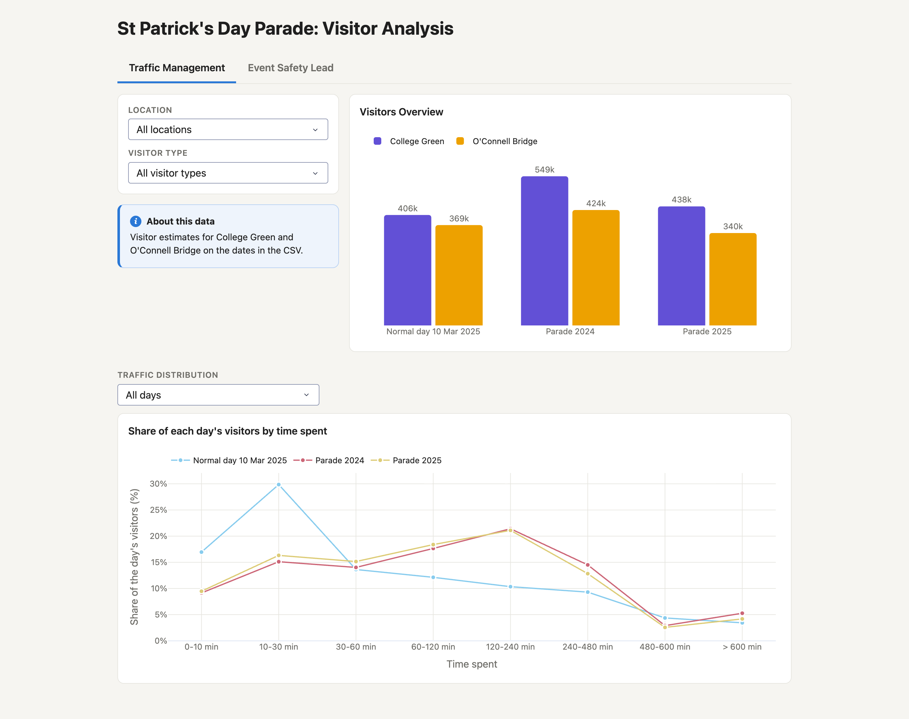
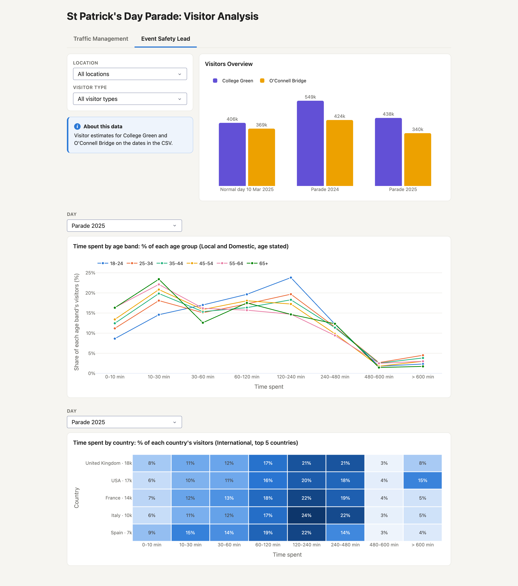

# Parade Visitor Analysis

A [Plotly Dash](https://dash.plotly.com/) dashboard comparing visitor numbers in Dublin city centre (College Green and O'Connell Bridge) on St Patrick's Day parade days and normal days.

## Live app

- **Render:** https://parade-analytics.onrender.com
- **Custom domain:** https://analysis-parade.bloodcounts.info (HTTPS certificate pending)


Both run the same app on Render's free plan. After 15 minutes without visitors it sleeps, so the first visit can take 30–60 seconds.

## Purpose and Intended Users

The dashboard supports the people who plan and run the St Patrick's Day parade with evidence instead of estimates. It turns visitor counts from past parades and normal days into answers to the questions that shape the plan: how many people to expect, at which locations, how long they stay, and who they are.

- **Plan from past events.** Comparing parade days with a normal day shows how a parade changes demand. In the data so far, the most common stay on a normal day is 10–30 minutes, while on both parade days it is 2–4 hours. That affects staffing shifts, facilities and transport.
- **One shared picture.** Every team works from the same figures, so plans made by different groups are consistent with each other.
- **Focused views.** Each decision-maker gets their own tab, with only the charts and filters their role needs, filtered by location and by Local, Domestic or International visitors.
- **Ready for each new year.** Adding a new date to the CSV (and redeploying) adds it to every chart and comparison, so each parade's results feed into planning the next one.

The current roles are:

- **Traffic Management:** plans crowd flow and access around the route. Their tab shows how many people came to each location on each day, and how long visitors stayed, so busy spots and long stays can be planned for.
- **Event Safety Lead:** plans safety cover and stewarding. Their tab shows the same visitor overview, plus how long each age group stayed and how long visitors from the top 5 countries stayed, to help plan support for different groups of visitors.

More roles can be added as new tabs.

## Screenshots

### Traffic Management



### Event Safety Lead



## Charts and filters

| Tab | Chart | Controlled by |
|---|---|---|
| Both | **Visitors Overview**: visitors per day, one bar per location | Location, Visitor type |
| Traffic Management | **Share of each day's visitors by time spent**: one line per day | Location, Visitor type, Traffic Distribution (all days, parade days only, or one year's parade vs normal days) |
| Event Safety Lead | **Time spent by age band**: one line per age band, Local and Domestic visitors only (age isn't recorded for international visitors) | Location, Visitor type, Day |
| Event Safety Lead | **Time spent by country**: heatmap of the top 5 international countries; each row adds up to 100% | Location, Day |

## Data

The data is in `data/Tourism Sample Data 2026.csv`, and its columns are described in `data/Tourism Sample Data Dictionary 2026.csv`. Each row is an estimated number of visitors for one combination of location, date, gender, age band, time spent (`dwell_time`), country and visitor type (Local, Domestic or International). The numbers are extrapolated from telecoms data, so they are not whole numbers.

Day names come from the dates in the CSV: 17 March becomes **Parade &lt;year&gt;**, and any other date becomes **Normal day &lt;date&gt;**, for example "Normal day 10 Mar 2025". The CSV is read once when the app starts, so restart the app after changing it.

## Run locally

Requires Python 3.13+ and [uv](https://docs.astral.sh/uv/).

```bash
uv sync                          # create .venv and install dependencies
uv run python app.py             # open http://127.0.0.1:8050
PORT=8051 uv run python app.py   # use another port if 8050 is busy
uv run ruff check .              # lint
uv run ruff format .             # format
```

`python app.py` runs Dash's development server with debug mode on. Production uses gunicorn instead (see below).

## Deploy (Render)

The app is deployed on Render's free plan as a Python web service, built from the `master` branch. Every push to `master` redeploys it.

| Setting | Value |
|---|---|
| Build command | `pip install uv && uv sync --frozen --no-dev` |
| Start command | `.venv/bin/gunicorn app:server --bind 0.0.0.0:$PORT` |
| Environment variable | `PYTHON_VERSION=3.13.5` |

Because the build uses `--frozen`, commit `uv.lock` after any dependency change. On the free plan the app sleeps after 15 minutes without visitors, so the next visit takes 30–60 seconds to load. The custom domain is a CNAME record from `analysis-parade.bloodcounts.info` to `parade-analytics.onrender.com`.

Responses are compressed (`compress=True` with `flask-compress`), which cuts page downloads by about 80%.

## Project structure

| Path | Role |
|---|---|
| `app.py` | Entry point: creates the Dash app; `server` is what gunicorn runs |
| `layout.py` | The page: title, the two tabs, filters and chart cards |
| `callbacks.py` | Redraws each chart when a dropdown changes |
| `charts.py` | Builds the Plotly figures (no Dash code) |
| `data.py` | Loads, cleans, filters and summarises the CSV (pandas only) |
| `assets/style.css` | Page styling; Dash loads it automatically |
| `data/` | The tourism CSV and its data dictionary |
| `docs/screenshots/` | The screenshots in this README |

## To do

### Data and scalability
- [ ] **Move the data into a database.** Load the CSV into PostgreSQL (or SQLite/DuckDB for a single server) and let the database do the filtering and totals. New dates can then be added without redeploying, and the app no longer has to hold every row in memory.
- [ ] **Refresh data without a restart.** The CSV is read once at startup, so new data only appears after a redeploy. With a database, reload on a schedule or on each request.
- [ ] **Store pre-totalled data.** The 178,876 CSV rows reduce to about 4,000 unique combinations. Store or cache those totals instead of the raw rows.
- [ ] **Remove hard-coded values.** The location list (`data.py`), the "About this data" text (`layout.py`) and the 17 March parade date should come from the data or a config file, so new locations or events work without code changes. The top-5 limit in `callbacks.py` and `TOP_COUNTRIES = 15` in `data.py` should be one setting.

### Performance and hosting
- [ ] **Serve charts in parallel.** Add `--workers 1 --threads 4` to the gunicorn start command, so the 5 charts that load together don't queue behind each other.
- [ ] **Read the CSV once at startup.** `data.py` currently reads it twice (once just for the dates).
- [ ] **Avoid cold starts.** The free Render plan sleeps after 15 minutes without visitors; upgrade to Starter if the dashboard must always open instantly.
- [ ] **Add access control if needed.** The app is public to anyone with the link. Add a login (for example `dash-auth`) if the data shouldn't be public.

### Quality
- [ ] **Add tests.** The callback functions can be called directly; add `pytest` tests for `data.py` (cleaning, day labels, totals) and for each callback.
- [ ] **Add CI.** Run `ruff check`, `ruff format --check` and the tests on every push with GitHub Actions, before Render deploys.
- [ ] **Automate screenshots.** Regenerate `docs/screenshots/` with a script so they stay in sync with the app.
